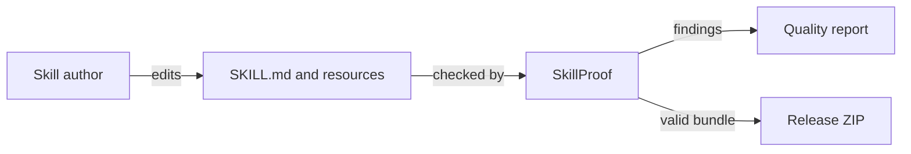

# Mermaid workflow example

Use explicit node IDs and short labels. Edge labels should describe the relationship.

This graph explains the path from an authored skill to the report and release archive. It makes no claim about a particular host's runtime behavior.
